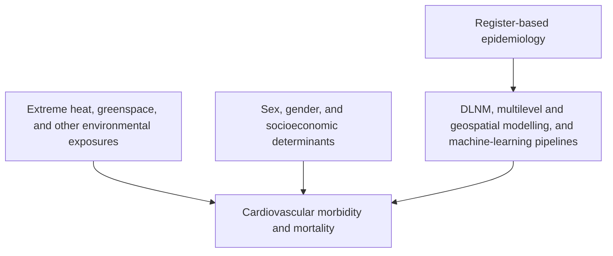

<picture>
  <source media="(prefers-color-scheme: dark)" srcset="assets/typing-dark.svg">
  <source media="(prefers-color-scheme: light)" srcset="assets/typing-light.svg">
  
</picture>

## Research interests

## Contributions

<picture>
  <source media="(prefers-color-scheme: dark)" srcset="https://raw.githubusercontent.com/yushengzhou/yushengzhou/output/github-snake-dark.svg">
  <source media="(prefers-color-scheme: light)" srcset="https://raw.githubusercontent.com/yushengzhou/yushengzhou/output/github-snake.svg">
  
</picture>

## Contact

- [Personal site](https://yushengzhou.github.io)
- [ORCID](https://orcid.org/0009-0003-6736-6496)
- [Email](mailto:yushengzhou29@hotmail.com)
